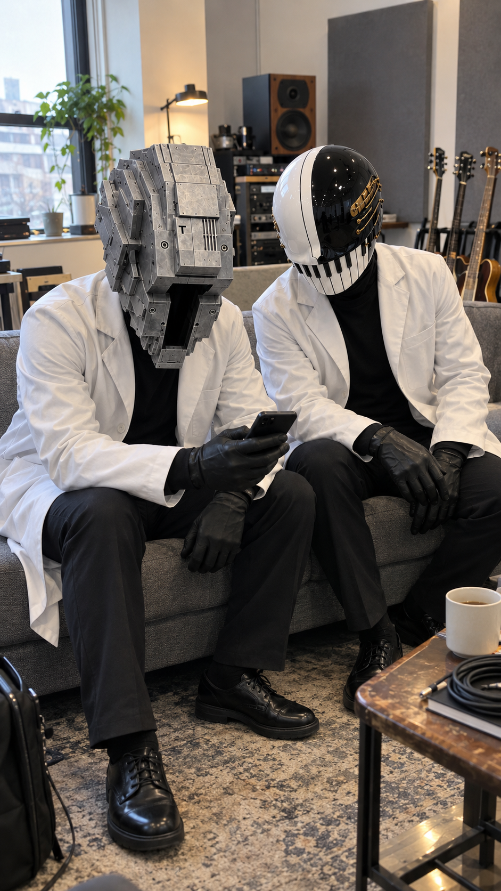
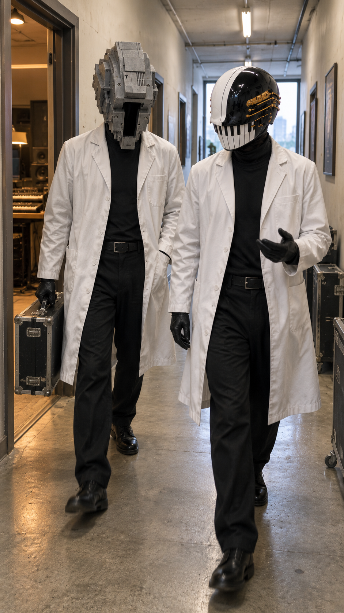
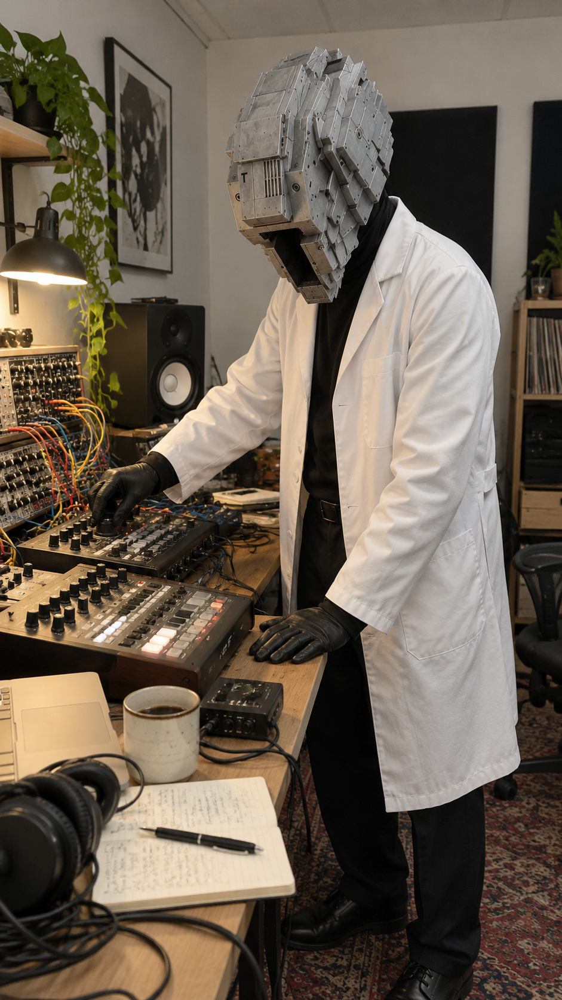
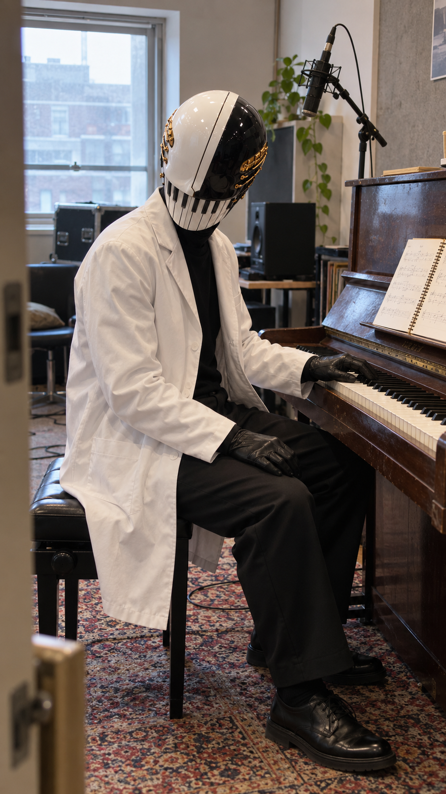
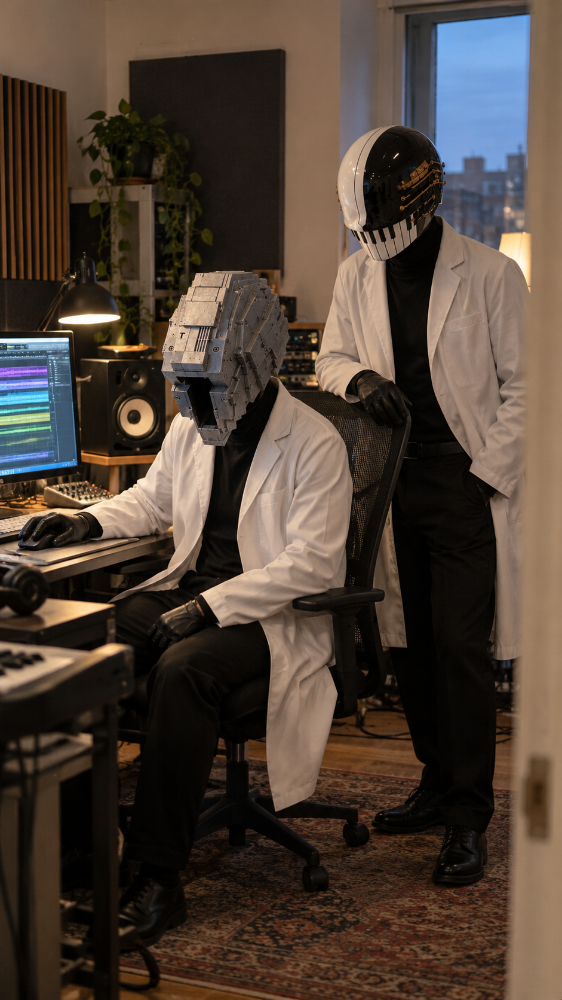
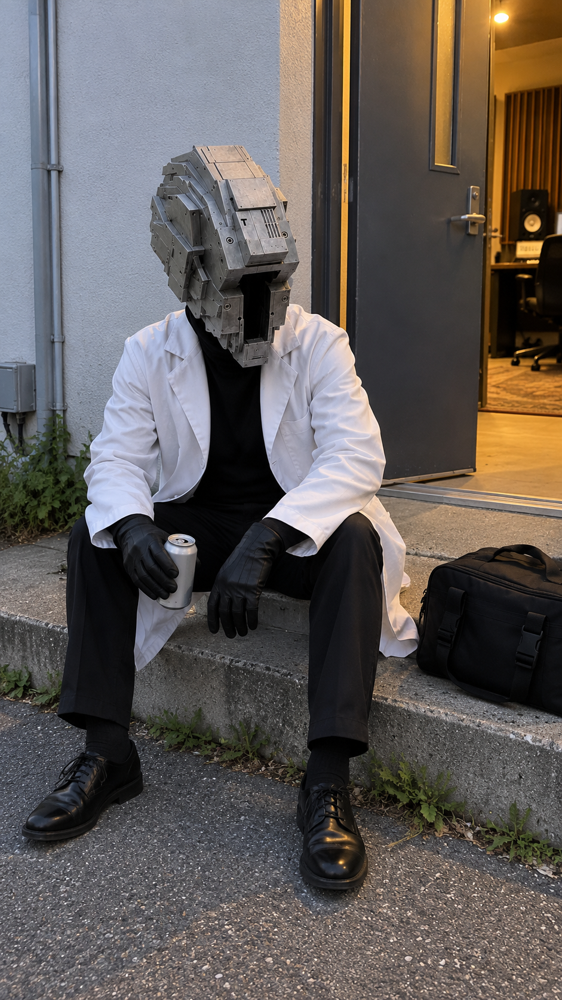

# MRI — Instagram宣伝用の生成オフショット

MRI_Music Resonance Imaging のキャラクターによる休憩・スタジオ制作の場面を描いた、AI生成の宣伝素材です。実際の収録・日常・舞台裏を撮影した記録ではありません。Instagram等へ再利用するときも、生成画像として説明してください。

2026-10-24にカタログへ追加。PNG 6枚、各941×1672px（縦長・約9:16）。元のファイル名・画像内容を保持しています。画像をクリックすると各PNGを開けます。

| シーン | プレビュー |
| --- | --- |
| 01 — 2人でスマホを見ながら休憩 |  |
| 02 — スタジオの廊下 |  |
| 03 — Technoのシンセ制作シーン |  |
| 04 — Pianoのピアノ制作シーン |  |
| 05 — 2人で再生確認 |  |
| 06 — Technoの屋外休憩 |  |

## メタデータと再利用

構造化メタデータの正本は、[MRIのartist YAML](../../../../../artists/mri-music-resonance-imaging.yaml) の `assets.concept_art` です。

- `github_path`: このリポジトリ内の画像パス。
- `status`: 素材の採用状態。今回の6枚は投稿ごとの採用を検討する `candidate` として登録。
- `role` / `description`: シーンの識別子と内容説明。
- `generation_method: ai-generated`: AI生成画像であることを明示。
- `intended_use: instagram-promotion`: Instagram宣伝素材としての再利用目的。
- `width_px` / `height_px`: 実ファイルで検証した画像寸法。

投稿案での表記例: 「MRIのスタジオ風景をイメージしたAI生成ビジュアル」。ファイル名の `Recording` や `Playback` は描写する場面を示し、実際の録音・再生確認を行った証拠ではありません。

[公開素材索引](../../../../README.md) · [Instagram宣伝ワークフロー](../../../../../docs/INSTAGRAM_PROMOTION_WORKFLOW.md)
