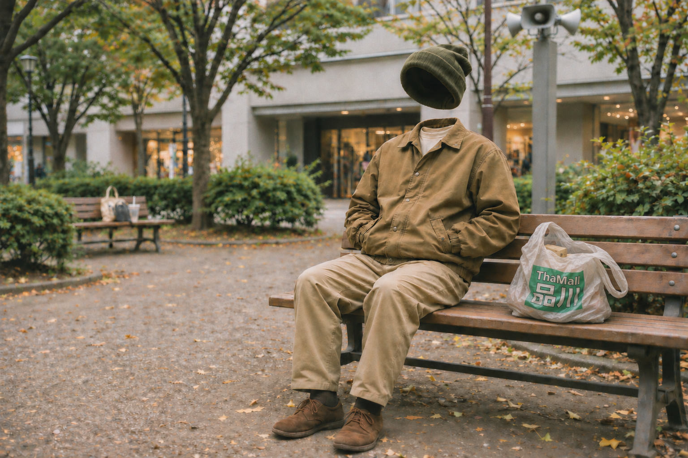

# ThaMall品川 — アーティスト写真

各PNGは下のファイルリンクから取得できます。[本人作成のロゴ原本](../logos/README.md)は別ディレクトリに保存しています。

## 袋なし版 — 現在の代表画像

2026-11-04に山田さんが採用・カタログ登録を指定した最終ビーニー修正版です。
代表画像の正本指定は `artists/thamall-shinagawa.yaml` の `assets.artist_image` にあり、素材一覧の採用状態は `selected` です。

- 公開ファイル: `thamall-shinagawa-artist-photo-revised-beanie-2026-11-04.png`
- 出典: 制作スレッドで共有された `thamall-shinagawa-artist-photo-revised-beanie.png`（Slack file ID: `F0CEJ881FPV`）
- 形式・解像度: PNG、1536 × 1024
- ファイルサイズ: 2,807,920 bytes
- SHA256: `bb45e95e4bba4108e12c859c756901db89483ed4d9dbf061edf0e392bd50a010`

背景店舗の文字・公園看板の除去、帽子位置の調整、Tシャツと靴下の追加、フィルムスナップ風の画質への修正後、ビーニーのサイズを元画像程度に戻した採用版です。元のJPEGや、ビーニー拡大前の初回修正版ではありません。

採用されたPNGをバイト単位で変更せず格納しています。カタログ登録時の再生成、切り抜き、拡大縮小、再圧縮は行っていません。

## 袋入り版 — 追加バリエーション

2026-11-04に山田さんが保管を指定した、取っ手が長く垂れたロゴ入りレジ袋の最終制作版です。
素材一覧では `candidate` / `crumpled-bag-variant` として参照します。今回の依頼は追加保管のため、代表画像への採用・切替は行っていません。

- 公開ファイル: [thamall-shinagawa-artist-photo-crumpled-bag-2026-11-04.png](thamall-shinagawa-artist-photo-crumpled-bag-2026-11-04.png)
- 元ファイル名: `thamall-shinagawa-artist-photo-crumpled-bag.png`
- 出典: 本人が保管を指定した制作画像の原本
- 形式・解像度: PNG、1536 × 1024
- ファイルサイズ: 2,487,709 bytes
- SHA256: `e9efc1a6a943db6191287c401c1e00744292345362d387fccdeff16c4c4afebd`

元PNGをバイト単位で変更せず保存しています。袋なし版も元のファイル名・内容・`selected` 状態で保持しています。
今後、袋の有無で使い分ける際はそれぞれのファイルを指定し、既存画像を上書きしないでください。代表画像の切替には別途本人の指定が必要です。
