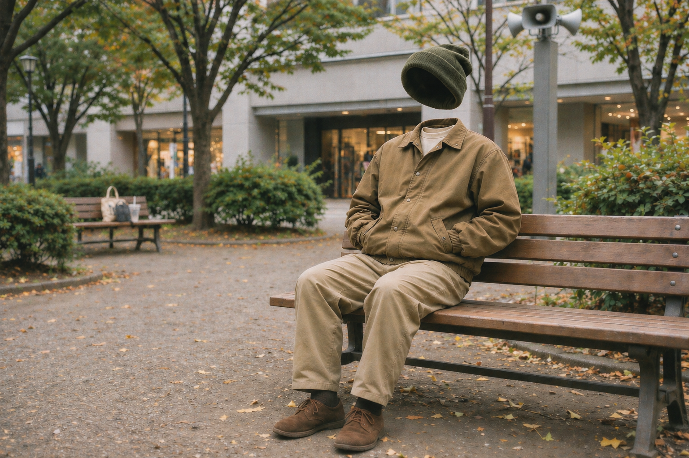

# ThaMall品川 — 正式アー写

2026-11-04に山田さんが採用・カタログ登録を指定した最終ビーニー修正版です。
代表画像の正本指定は `artists/thamall-shinagawa.yaml` の `assets.artist_image` にあり、素材一覧の採用状態は `selected` です。

- 公開ファイル: `thamall-shinagawa-artist-photo-revised-beanie-2026-11-04.png`
- 出典: 制作スレッドで共有された `thamall-shinagawa-artist-photo-revised-beanie.png`（Slack file ID: `F0CEJ881FPV`）
- 形式・解像度: PNG、1536 × 1024
- ファイルサイズ: 2,807,920 bytes
- SHA256: `bb45e95e4bba4108e12c859c756901db89483ed4d9dbf061edf0e392bd50a010`

背景店舗の文字・公園看板の除去、帽子位置の調整、Tシャツと靴下の追加、フィルムスナップ風の画質への修正後、ビーニーのサイズを元画像程度に戻した採用版です。元のJPEGや、ビーニー拡大前の初回修正版ではありません。

採用されたPNGをバイト単位で変更せず格納しています。カタログ登録時の再生成、切り抜き、拡大縮小、再圧縮は行っていません。
